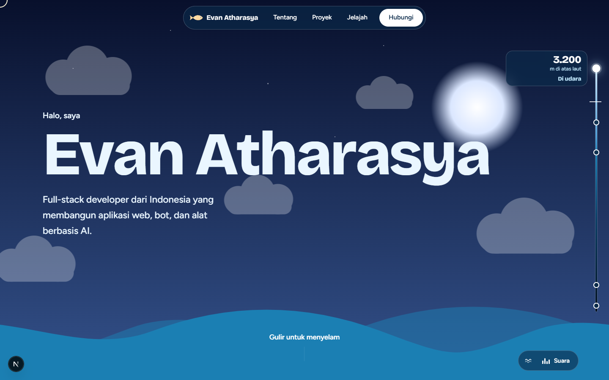
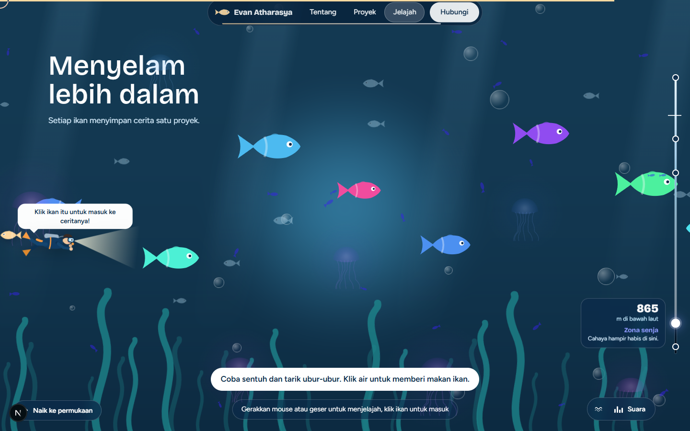
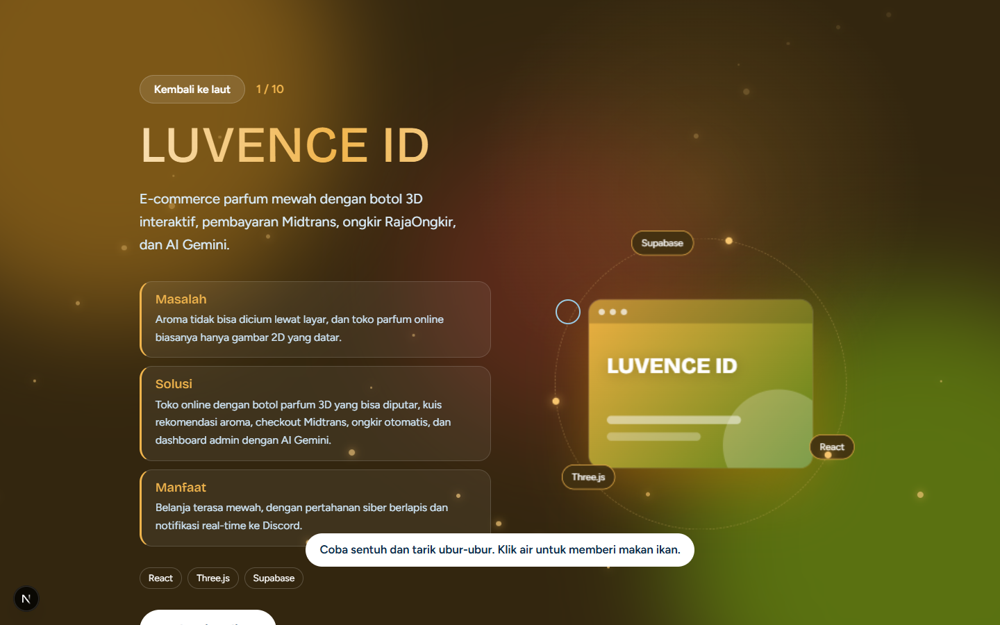
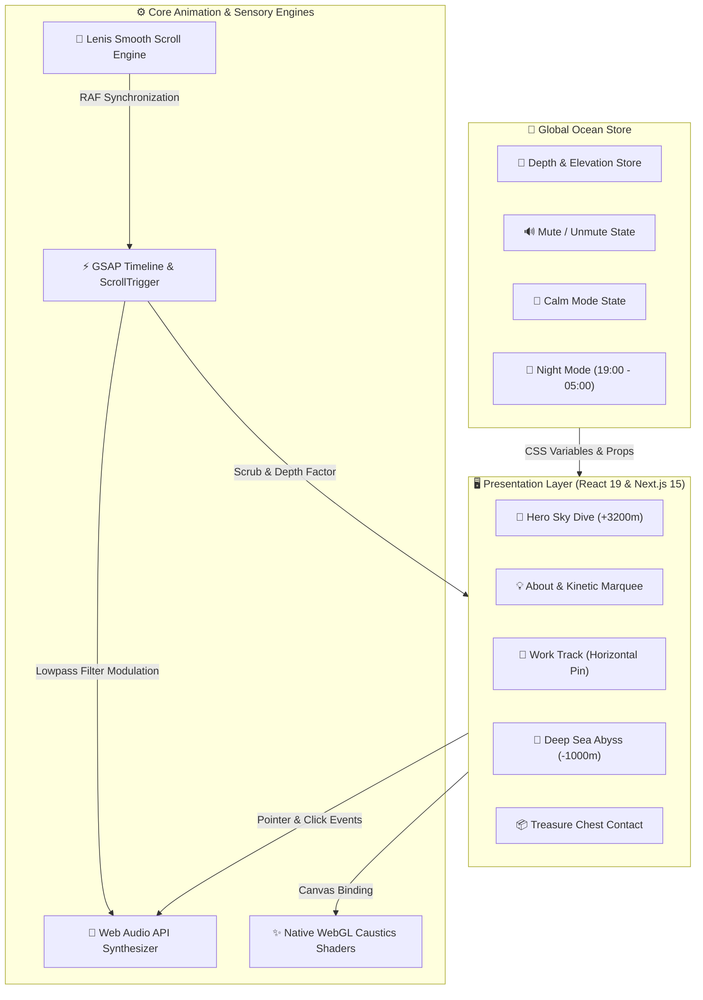

<div align="center">

  # 🌊 Evan Atharasya · Portofolio
  ### *Deep-Sea Interactive Experience & Creative Web Development*

  <p align="center">
    Situs portofolio interaktif modern berkinerja tinggi yang menggabungkan <b>Storytelling Visual</b>, <b>Simulasi Fisika Bawah Laut</b>, dan <b>Arsitektur Frontend State-of-the-Art</b>.
  </p>

  <!-- Badges -->
  <p align="center">
    <a href="https://nextjs.org/"></a>
    <a href="https://react.dev/"></a>
    <a href="https://www.typescriptlang.org/"></a>
    <a href="https://tailwindcss.com/"></a>
    <a href="https://gsap.com/"></a>
    <a href="https://lenis.darkroom.engineering/"></a>
  </p>
  <p align="center">
    
    
    
    
    
  </p>

  <p align="center">
    <a href="#-peta-fitur--keunggulan-kreatif"><b>✨ Fitur Unggulan</b></a> •
    <a href="#-showcase-visual"><b>📸 Visual Showcase</b></a> •
    <a href="#-arsitektur--koordinasi-sistem"><b>🏗️ Arsitektur</b></a> •
    <a href="#-kontrol-interaktif--pintasan-keyboard"><b>⌨️ Kontrol</b></a> •
    <a href="#-panduan-instalasi--menjalankan"><b>🚀 Mulai Cepat</b></a>
  </p>

</div>

---

## 📸 Showcase Visual

<div align="center">
  <table>
    <tr>
      <td width="50%" align="center">
        <b>🌌 Hero Sky Dive & Night Mode (+3.200 m)</b><br/><br/>
        
      </td>
      <td width="50%" align="center">
        <b>🌊 Deep Sea Abyss & Curious Fish (-865 m)</b><br/><br/>
        
      </td>
    </tr>
    <tr>
      <td colspan="2" align="center">
        <b>📖 Interactive Project Portal & 3D Orbiting Chips</b><br/><br/>
        
      </td>
    </tr>
  </table>
</div>

---

## ✨ Peta Fitur & Keunggulan Kreatif

### 1. 🌌 Sky-to-Abyss Elevation Engine
- **Perjalanan Vertikal Terkoordinasi**: Pengunjung memulai perjalanan dari angkasa (+3.200 m), terjun menembus awan dan ombak laut (0 m), hingga mencapai palung laut terdalam (-1.000 m Zona Senja).
- **Dynamic Background Depth Tweening**: Variabel CSS `--c` dihitung dan diinterpolasi halus sepanjang dokumen dari warna biru muda udara `rgb(27, 127, 179)` hingga biru pekat abisal `rgb(3, 17, 31)`.
- **Altitude & Depth Gauge Rail**: Indikator instrumen vertikal di sisi kanan layar dengan kalkulasi posisi presisi, riak air saat menembus permukaan, dan penanda checkpoint yang dapat diklik untuk *fast travel*.

### 2. 🎵 Procedural Web Audio Synthesizer (Zero External Audio Files)
- **100% Native Web Audio API**: Seluruh efek suara dihasilkan secara matematis tanpa mengunduh file `.mp3` eksternal (menghemat bandwidth dan latensi 0ms).
- **Dynamic Ambience**: Suara desir angin di angkasa, deburan ombak *brown noise* saat menyelam, dan filter *lowpass* yang otomatis meredam frekuensi semakin dalam pengguna menyelam.
- **Micro-Sound FX**: Sintesis audio prosedural untuk gelembung air saat klik, kibasan ekor ikan (*whoosh*), dentang peti harta karun, dan interaksi tombol.

### 3. ✨ Native WebGL Caustics Shader
- **Rendering Refraksi Cahaya Air Prosedural**: Shader GLSL native kustom tanpa dependensi berat Three.js.
- **Performa Tinggi & Hemat Baterai**: Berjalan pada resolusi 0.5x dengan hardware acceleration dan otomatis berhenti (*auto-pause*) saat tab browser tidak aktif atau di luar jangkauan viewport.

### 4. 🐟 Ekosistem Laut Hidup & Curious Fish AI
- **Ikan Penasaran (Interactive Curiosity)**: Kawanan ikan di laut dalam akan berenang mendekat saat kursor diarahkan ke dekatnya (< 300px), dan bergerak menjauh dengan kibasan ekor dinamis saat diklik.
- **Karakter Buddy Diver**: Karakter penyelam animasi dengan senter navigasi yang sudut kepalanya mengikuti kursor secara kontinu tanpa osilasi patah.
- **Simulasi Ubur-Ubur & Rumput Laut Prosedural**: Rumput laut bergoyang dinamis dengan SVG pathing dan ubur-ubur bercahaya yang dapat ditarik (*draggable*).

### 5. 📖 Project Portal (Studi Kasus Lingkaran Interaktif)
- **Circular Zoom Transition**: Membuka modal studi kasus dengan efek lingkaran membesar (*clip-path circle reveal*) langsung dari koordinat mata ikan atau kartu yang diklik.
- **3D Window Mockup & Orbiting Chips**: Jendela mockup proyek 3D dengan tag teknologi yang mengorbit secara tiga dimensi dan bereaksi terhadap pergerakan mouse.
- **Struktur Studi Kasus Mendalam**: Setiap proyek dilengkapi analisis masalah, solusi arsitektur, dan dampak bisnis (*business value*).

### 6. 🌙 Sistem Waktu Otomatis (Day & Night Mode)
- **Real-time Environment Engine**: Mendeteksi waktu lokal perangkat pengguna secara otomatis. Saat memasuki pukul **19:00 - 05:00**, langit Hero otomatis berganti menjadi malam berbintang dengan bulan bersinar lembut dan skema gradien malam.
- Dilengkapi timer interval sinkronisasi aktif setiap 10 detik.

### 7. ♿ Aksesibilitas & Mode Ramah Sensorik
- **Calm Mode (Mode Tenang)**: Tombol sekali klik untuk menonaktifkan seluruh animasi makhluk laut, gelembung, dan distorsi jika pengguna menginginkan pengalaman membaca minimalis.
- **Prefers-Reduced-Motion Support**: Menghormati pengaturan aksesibilitas sistem operasi secara komprehensif.

---

## 🏗️ Arsitektur & Koordinasi Sistem



---

## ⌨️ Kontrol Interaktif & Pintasan Keyboard

Situs ini dirancang untuk mendukung eksplorasi interaktif baik melalui kursor mouse, layar sentuh, maupun papan ketik:

| Tombol / Aksi | Fungsi | Bagian |
| :--- | :--- | :--- |
| <kbd>?</kbd> | Membuka panduan bantuan & pintasan keyboard | Global |
| <kbd>C</kbd> | Mengaktifkan / menonaktifkan **Calm Mode** (Mode Tenang) | Global |
| <kbd>M</kbd> | Membisukan / mengaktifkan suara audio laut (**Mute**) | Global |
| <kbd>Esc</kbd> | Menutup modal studi kasus (*Project Portal*) atau menu mobile | Global |
| <kbd>→</kbd> / <kbd>←</kbd> | Berpindah ke proyek berikutnya / sebelumnya | Project Portal |
| **Klik Air di Laut Dalam** | Memberi makan ikan & memicu riak gelombang air | Laut Dalam (`#deep`) |
| **Sentuh / Geser Ubur-Ubur** | Menarik dan memantulkan ubur-ubur laut | Laut Dalam (`#deep`) |
| **Klik Peti Emas** | Membuka peti harta karun dengan letupan koin emas | Kontak (`#contact`) |

---

## 🛠️ Tech Stack & Library

| Kategori | Teknologi | Deskripsi |
| :--- | :--- | :--- |
| **Framework** | [Next.js 15](https://nextjs.org/) | App Router, Server & Client Components, React 19 architecture |
| **Bahasa** | [TypeScript](https://www.typescriptlang.org/) | Strict mode, zero `any` pada data dan konfigurasi inti |
| **Styling** | [Tailwind CSS v4](https://tailwindcss.com/) | Native CSS design tokens, modern responsive utilities |
| **Animasi** | [GSAP 3](https://gsap.com/) & ScrollTrigger | Scrub timeline, container animations, stagger, lerp quickTo |
| **Smooth Scroll**| [Lenis](https://lenis.darkroom.engineering/) | Momentum-based physics scroll yang di-sync dengan GSAP ticker |
| **Typography** | `next/font/google` | [Bricolage Grotesque](https://fonts.google.com/specimen/Bricolage+Grotesque) & [Figtree](https://fonts.google.com/specimen/Figtree) |
| **Graphics** | Native WebGL | Fragment & vertex shader refraction tanpa Three.js overhead |
| **Audio** | Web Audio API | Native procedural sound wave synthesizer & filter nodes |
| **Testing** | [Playwright](https://playwright.dev/) | End-to-end smoke testing di desktop & mobile viewports |

---

## 📁 Struktur Direktori

```plaintext
├── docs/
│   ├── INVENTORY.md               # Analisis komprehensif kode sumber awal
│   └── PORTING_NOTES.md           # Log detail migrasi arsitektur modular Next.js
├── public/
│   ├── preview.png                # Tangkapan layar preview Hero
│   ├── deep_preview.png           # Tangkapan layar preview Deep Sea
│   └── portal_preview.png         # Tangkapan layar preview Project Portal
├── src/
│   ├── app/
│   │   ├── globals.css            # Token desain, keyframes, dan styling komponen
│   │   ├── layout.tsx             # Root layout, Google fonts, dynamic metadata
│   │   ├── page.tsx               # Orchestrator halaman utama & state koordinasi
│   │   ├── opengraph-image.tsx    # Dynamic OpenGraph card generation
│   │   ├── robots.ts              # Konfigurasi perayap SEO
│   │   └── sitemap.ts             # Sitemap XML otomatis
│   ├── components/
│   │   ├── fx/                    # Shaders, Caustics, Bubbles, Clouds, Birds, Tide, Buddy
│   │   ├── layout/                # Nav, MobileMenu, Gauge, Cursor, AudioControl, Toast
│   │   ├── portal/                # ProjectPortal, OrbitMock 3D window
│   │   └── sections/              # Hero, About, KineticMarquee, Work, Deep, Contact, TreasureChest
│   ├── data/
│   │   ├── projects.ts            # Typed database proyek & narasi studi kasus
│   │   ├── site.ts                # Konfigurasi identitas situs, statistik, sosial media
│   │   └── skills.ts              # Data keahlian teknis marquee
│   ├── hooks/                     # useLenis, useReducedMotion, useNightMode
│   ├── lib/
│   │   ├── audioEngine.ts         # Native Web Audio synthesizer engine
│   │   ├── gsap.ts                # Registrasi GSAP & ScrollTrigger terpusat
│   │   ├── math.ts                # Fungsi pembantu interpolasi matematis & clamping
│   │   ├── oceanStore.ts          # State store reaktif untuk koordinasi audio, depth, dan toast
│   │   └── shaders.ts             # GLSL shader program untuk WebGL caustics
│   └── types/
│       └── project.ts             # Definisi interface TypeScript proyek & tema
├── tests/
│   └── smoke.spec.ts              # 7 skenario uji otomatis Playwright
├── package.json
└── tsconfig.json
```

---

## 🚀 Panduan Instalasi & Menjalankan

### Prasyarat
- **Node.js** >= 18 (direkomendasikan v20 ke atas)
- **pnpm** >= 9 (atau `npm` / `yarn` / `bun`)

### 1. Clone Repositori
```bash
git clone https://github.com/ESTAS-crypto/portofolio.git
cd portofolio
```

### 2. Instal Dependensi
Pilih package manager favorit Anda:

```bash
# Menggunakan pnpm (disarankan)
pnpm install

# Atau menggunakan npm
npm install

# Atau menggunakan yarn
yarn install

# Atau menggunakan bun
bun install
```

### 3. Jalankan Server Pengembangan
```bash
pnpm run dev
# atau npm run dev
```
Buka peramban Anda di `http://localhost:3000`.

### 4. Build untuk Lingkungan Produksi
```bash
pnpm run build
pnpm run start
# atau npm run build && npm run start
```

### 5. Jalankan Pengujian Otomatis (E2E Tests)
Proyek ini dilengkapi rangkaian pengujian Playwright komprehensif yang mencakup seluruh alur navigasi, modal, audio, dan mode tenang:
```bash
pnpm run test:smoke
# atau npx playwright test
```

---

## ☁️ Panduan Deploy ke Vercel

Situs ini siap dideploy dengan integrasi CI/CD otomatis ke [Vercel](https://vercel.com/):

[](https://vercel.com/new/clone?repository-url=https%3A%2F%2Fgithub.com%2FESTAS-crypto%2Fportofolio)

### Opsi CLI:
```bash
pnpm dlx vercel
```

---

## 👤 Pembuat & Kontak

**Evan Atharasya**  
*Creative Developer & Full-Stack Engineer*

- 🌐 **GitHub**: [@ESTAS-crypto](https://github.com/ESTAS-crypto)
- 💼 **LinkedIn**: [Evan Atharasya](https://linkedin.com)
- 📧 **Email**: [evanatharasya@gmail.com](mailto:evanatharasya@gmail.com)

---

<div align="center">
  <sub>Dibuat dengan dedikasi penuh, secangkir kopi, dan deburan ombak laut yang tenang. 🌊</sub>
</div>
